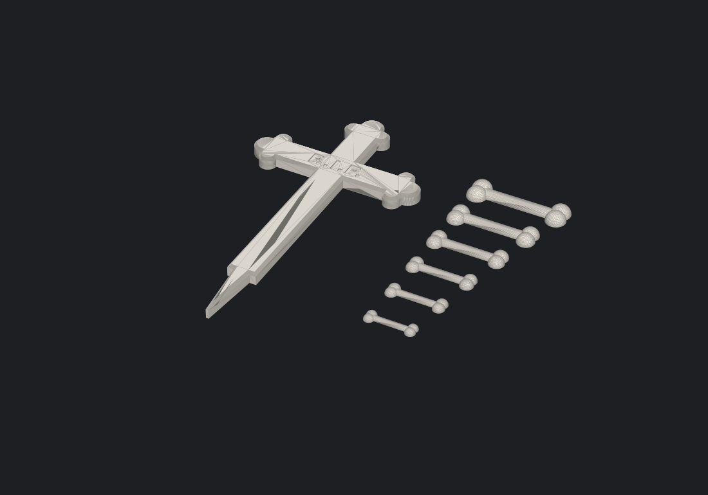
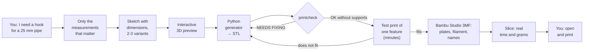
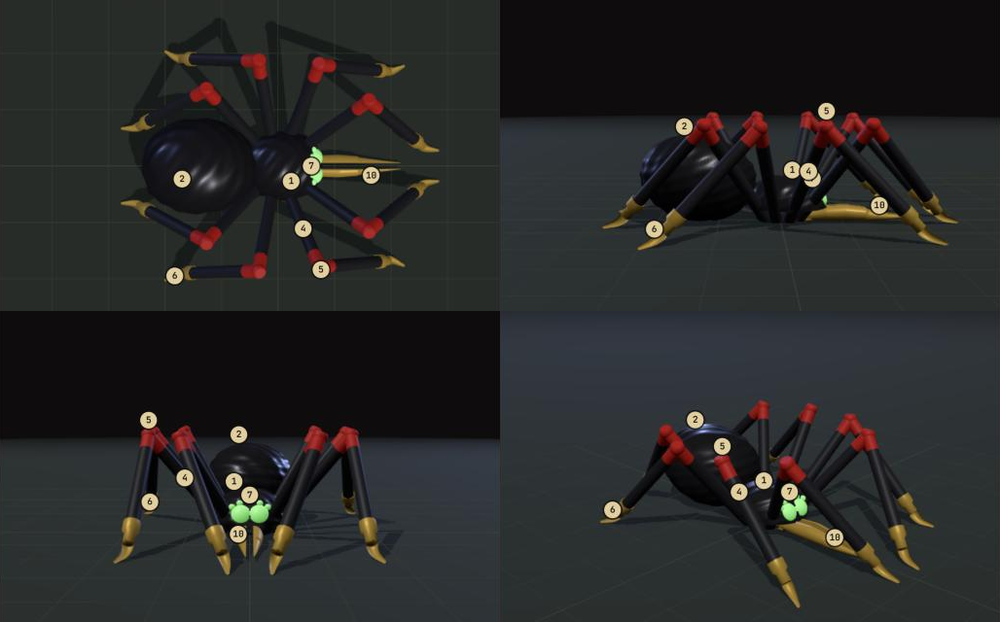
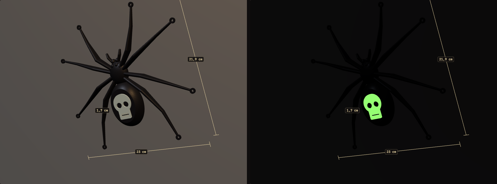

# 3d-model-skills

Agent skills that take you from "I need a part that does X" to a Bambu Studio project you only open and print.

You describe the part. The agent asks for the few measurements that matter, draws a sketch with dimensions, shows an interactive 3D preview, writes a parametric Python model, checks that it prints without supports, has you print a tiny test of the uncertain fit, and hands over a `.3mf` with plates, filaments and print time already set.

Made for [Claude Code](https://claude.com/claude-code) and built while making Halloween decorations on a Bambu Lab P1S.



## How it works



| Step | What you get |
|---|---|
| Sketch | A cross-section or side view with labelled parts and key dimensions, before any modelling. |
| 3D preview | A single HTML page (three.js): rotate the build, numbered parts, dimension lines, parts list, build steps. In the Claude app it is published as an artifact. |
| Generator | `model/generate.py` with all sizes as parameters at the top. Change a number, run it again. |
| printcheck | A layer-by-layer check for overhangs, long bridges, parts starting in the air, loose pieces and materials that will not bond. |
| Minimal test | Only the uncertain feature (one pin in one hole, one magnet pocket) in the same orientation as the final part. A few minutes of printing instead of a failed big part. |
| 3MF project | Parts already rotated and placed on named plates, filament presets and colours set, project description filled in. |
| Slicing | Real print time and grams per plate from the Bambu Studio CLI. |

## Gallery

Interactive previews made with the `3d-preview` skill:





## What is inside

```
skills/
  3d-print-design/         workflow and design rules (orientation, fits, joints, materials)
    SKILL.md
    scripts/
      printcheck.py        support-free check, --png draws where the problems are
      selftest.py          16 shapes with a known result, run after changing printcheck
      bambu3mf.py          write_3mf(): Bambu Studio project with plates and filaments
      bambu_slice.py       slice a 3MF safely and print time + grams (Windows)
      templates/           P1S project settings used as the default printer
  3d-preview/
    SKILL.md               interactive three.js build preview with dimensions
examples/
  grave-cross/             full example: generator → printcheck → 3MF
```

## Install

Requirements: Python 3.12+ and [Bambu Studio](https://github.com/bambulab/BambuStudio) (its filament presets are used for the 3MF).

```bash
pip install manifold3d trimesh numpy matplotlib
```

**Claude Code** (as a plugin):

```
/plugin marketplace add magiak/3d-model-skills
/plugin install 3d-model-skills@magiak
```

Or copy the folders from `skills/` into `~/.claude/skills/`.

The skills use the open Agent Skills format (`SKILL.md`), so other agents that support it can read them too.

Then just ask: *"Design a wall hook for a 25 mm broom handle, black PETG."*

## Try the example

```bash
python examples/grave-cross/generate.py
```

It writes [grave-cross.3mf](examples/grave-cross/grave-cross.3mf) (2 plates, white PLA, also committed so you can open it right away) and runs printcheck on every part:

```
== cross  (layer 0.2, overhang 45.0°, bridge ≤ 30.0 mm)
  RESULT: OK without supports
```

A part with a problem looks like this:

```
== shelf  (layer 0.2, overhang 45.0°, bridge ≤ 30.0 mm)
  SUPPORTS: 2×
    shelf: z 20.1–20.1 mm, area 148 mm², length 30.0 mm, at x=13 y=0
    shelf: z 20.1–20.1 mm, area 148 mm², length 30.0 mm, at x=-13 y=0
  RESULT: NEEDS FIXING
```

Slicing it (Windows):

```bash
python skills/3d-print-design/scripts/bambu_slice.py examples/grave-cross/grave-cross.3mf
```

On a P1S with 0.20 mm layers this gave 57 min / 29 g for the cross and 38 min / 10 g for the bones.

## Design rules in short

- One filament per part. Two materials = two parts that snap or pin together.
- No supports: chamfers instead of overhangs, overhangs up to 45°, short bridges.
- Flat bands lying on the bed instead of round rods, unless the function needs round.
- Round pin in a round hole for joints, teardrop for horizontal holes.
- Every uncertain fit goes into a test print of that one feature first.
- Never read a downloaded model's shape from its bounding box.

The full rules with tested clearances are in [skills/3d-print-design/SKILL.md](skills/3d-print-design/SKILL.md).

## Limits

- The default printer is a Bambu Lab P1S with a 0.4 mm nozzle. For another printer, save a Bambu Studio project with one filament and pass it as `template` (see [templates/README.md](skills/3d-print-design/scripts/templates/README.md)).
- `bambu_slice.py` runs on Windows only. On macOS or Linux call the Bambu Studio CLI yourself.
- The tested clearances come from one P1S printing PETG. Check them with a test print on your printer.

## License

MIT. The printer template `p1s_project_settings.config` comes from Bambu Studio and is AGPL-3.0.

Unofficial project, not affiliated with Bambu Lab.
