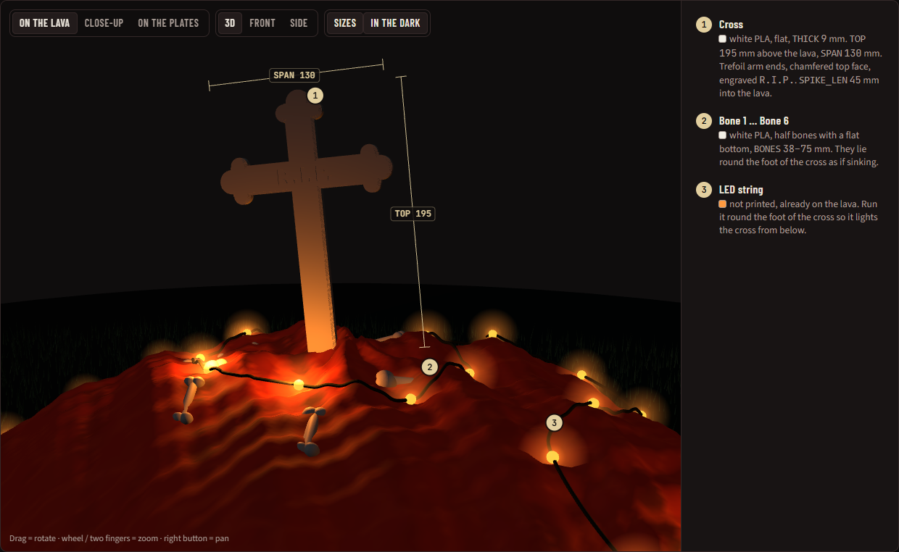
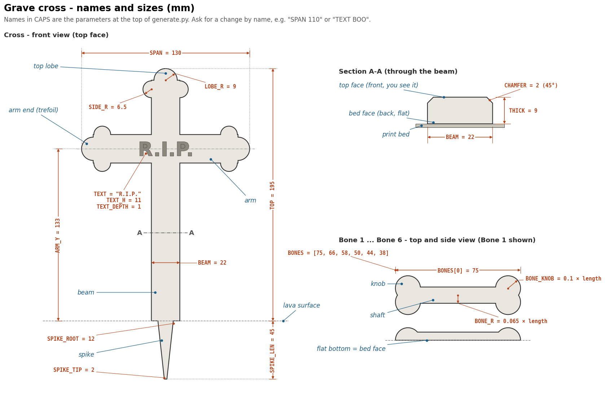
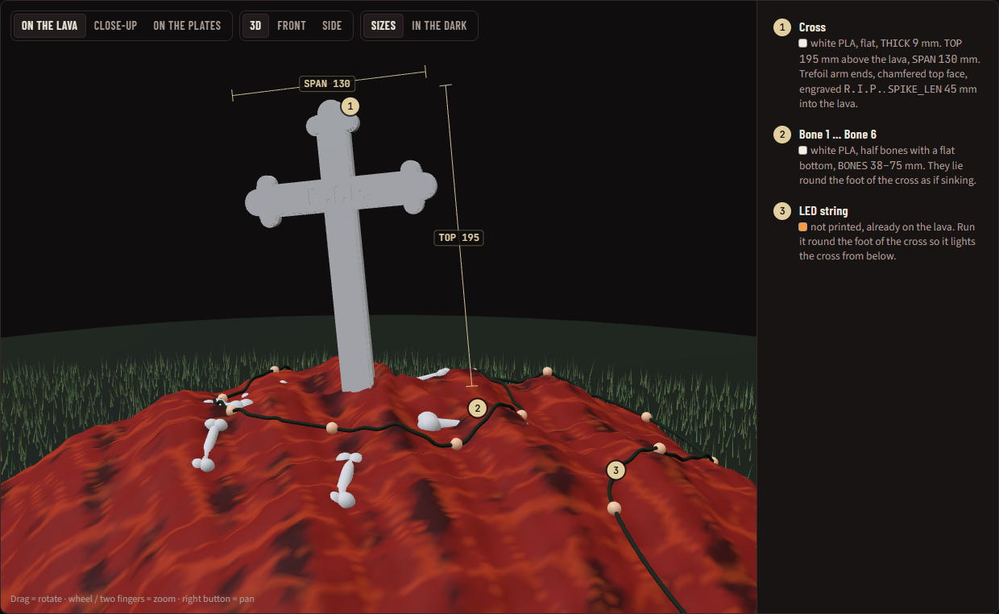
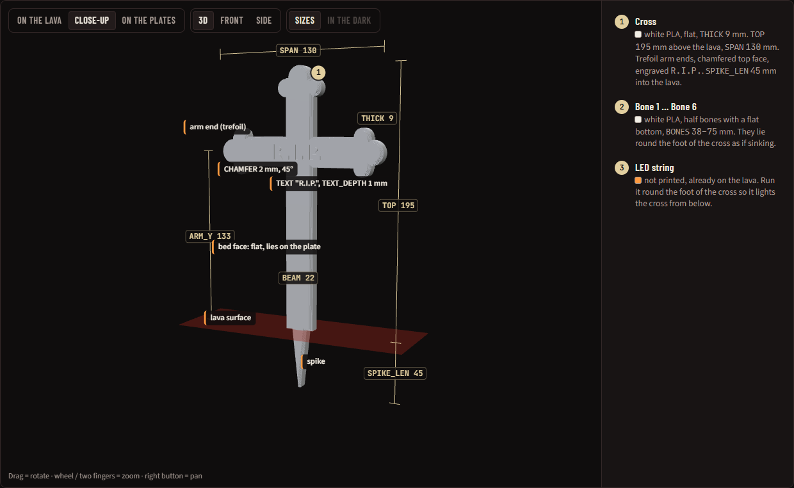
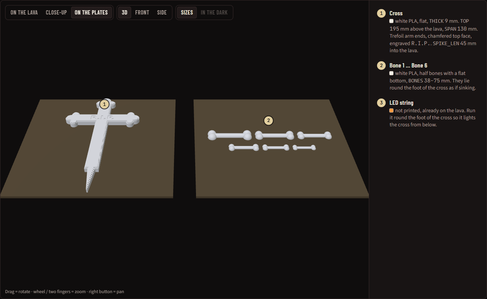
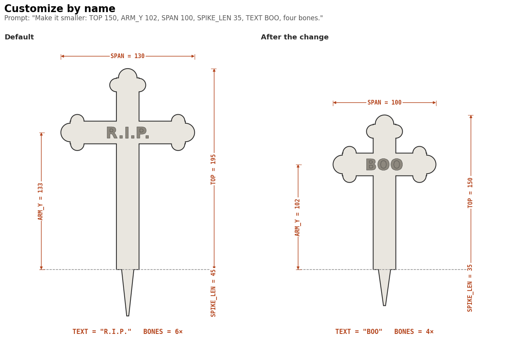
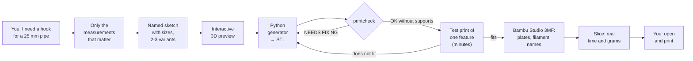

# 3d-model-skills

Agent skills that take you from "I need a part that does X" to a Bambu Studio project you only open and print.

You describe the part. The agent asks for the few measurements that matter, draws a sketch where every part, face and size has a name, shows an interactive 3D preview, writes a parametric Python model, checks that it prints without supports, has you print a tiny test of the uncertain fit, and hands over a `.3mf` with plates, filaments and print time already set.

Made for [Claude Code](https://claude.com/claude-code) and built while making Halloween decorations on a Bambu Lab P1S.



## Example: from prompt to print

Everything below is in [examples/grave-cross](examples/grave-cross) and was made with these skills for a real Halloween decoration.

### 1. The prompt

> I have a lump of fake lava with an LED string on it. Put something scary in the middle of it.

(Reconstructed from the original Czech conversation, shortened.) The first proposal was a skull. The answer was "that does not look scary", so it became a graveyard cross with small bones sinking round its foot.

Two things stayed open: what the lump is made of and how big it is. So the cross got a plain spike (`SPIKE_LEN`) and the preview assumes a lump of about 60 cm.

### 2. The sketch: every size has a name



The labels in CAPS are the parameters at the top of [generate.py](examples/grave-cross/generate.py). Parts (*arm*, *beam*, *spike*), faces (*top face* you see, *bed face* that lies on the plate) and features (*trefoil arm end*, *knob*) have names too. So you can say "make the spike longer" or "SPAN 110" and both the agent and you know exactly what changes. The generator draws this sketch itself, so it always matches the model.

### 3. The 3D preview

[preview.html](examples/grave-cross/preview.html) is a single page (three.js). Download the folder and open it from disk: the meshes come from `meshes.js` next to it. In the Claude app the agent publishes it as an artifact.

| On the lava | Close-up with sizes | On the plates |
|---|---|---|
|  |  |  |

The sizes in the preview use the same names as the sketch. The plates view is a sketch of the layout: the real placement is in the 3MF.

### 4. The generator

All sizes are one line each at the top of `generate.py`:

```python
TOP = 195.0                       # lava surface to the tip of the top lobe
ARM_Y = 133.0                     # lava surface to the arm axis
SPAN = 130.0                      # arm end to arm end
SPIKE_LEN = 45.0                  # spike into the lava, below the lava surface
TEXT = "R.I.P."
BONES = [75.0, 66.0, 58.0, 50.0, 44.0, 38.0]      # one bone per length
```

```bash
python examples/grave-cross/generate.py
```

It writes the STLs, `sketch.png`, `meshes.js` for the preview and `grave-cross.3mf`, then runs printcheck on every part:

```
== cross  (layer 0.2, overhang 45.0°, bridge ≤ 30.0 mm)
  RESULT: OK without supports
```

A part with a problem looks like this:

```
== shelf  (layer 0.2, overhang 45.0°, bridge ≤ 30.0 mm)
  SUPPORTS: 2×
    shelf: z 20.1–20.1 mm, area 148 mm², length 30.0 mm, at x=13 y=0
    shelf: z 20.1–20.1 mm, area 148 mm², length 30.0 mm, at x=-13 y=0
  RESULT: NEEDS FIXING
```

### 5. Test print

Not needed here: nothing slides into anything and there are no clearances. If the cross had to plug into a printed base, the test would be just the spike end and one socket, a few minutes of printing, in the same orientation as the final parts.

### 6. The 3MF and the slice

[grave-cross.3mf](examples/grave-cross/grave-cross.3mf) has two plates, "1 Cross - white PLA" and "2 Bones - white PLA", one filament and a filled-in project description. Slicing it (Windows):

```bash
python skills/3d-print-design/scripts/bambu_slice.py examples/grave-cross/grave-cross.3mf
```

On a P1S with 0.20 mm Standard: cross 57 min / 29 g, bones 38 min / 10 g. No filament changes.

### 7. Customize it

Ask by name, the agent changes the lines in `generate.py` and runs it again:

| You say | What changes |
|---|---|
| "Make it smaller: TOP 150, ARM_Y 102, SPAN 100" | cross height, arm position, arm width |
| "Shorter spike, the lump is hard" | `SPIKE_LEN` |
| "Write BOO instead" | `TEXT` |
| "Only four bones" | `BONES = [60, 50, 42, 36]` |
| "Thicker cross" | `THICK` (print height and time) |



The smaller variant above also passed printcheck "OK without supports" for the cross and all four bones.

## How it works



| Step | What you get |
|---|---|
| Sketch | Views with named parts, faces and features, and every size labelled with its parameter name, before any modelling. |
| 3D preview | A single HTML page (three.js): rotate the build, numbered parts, dimension lines, parts list, build steps. In the Claude app it is published as an artifact. |
| Generator | `model/generate.py` with all sizes as parameters at the top. Change a number, run it again. |
| printcheck | A layer-by-layer check for overhangs, long bridges, parts starting in the air, loose pieces and materials that will not bond. |
| Minimal test | Only the uncertain feature (one pin in one hole, one magnet pocket) in the same orientation as the final part. A few minutes of printing instead of a failed big part. |
| 3MF project | Parts already rotated and placed on named plates, filament presets and colours set, project description filled in. |
| Slicing | Real print time and grams per plate from the Bambu Studio CLI. |

## Gallery

Interactive previews made with the `3d-preview` skill:


## What is inside

```
skills/
  3d-print-design/         workflow and design rules (orientation, fits, joints, materials)
    SKILL.md
    scripts/
      printcheck.py        support-free check, --png draws where the problems are
      sketch.py            named sketches: dimension lines labelled with parameter names
      selftest.py          16 shapes with a known result, run after changing printcheck
      bambu3mf.py          write_3mf(): Bambu Studio project with plates and filaments
      bambu_slice.py       slice a 3MF safely and print time + grams (Windows)
      templates/           P1S project settings used as the default printer
  3d-preview/
    SKILL.md               interactive three.js build preview with dimensions
examples/
  grave-cross/             full example: generate.py → sketch.png, preview.html, printcheck, grave-cross.3mf
```

## Install

Requirements: Python 3.12+ and [Bambu Studio](https://github.com/bambulab/BambuStudio) (its filament presets are used for the 3MF).

```bash
pip install manifold3d trimesh numpy matplotlib
```

**Claude Code** (as a plugin):

```
/plugin marketplace add magiak/3d-model-skills
/plugin install 3d-model-skills@magiak
```

Or copy the folders from `skills/` into `~/.claude/skills/`.

The skills use the open Agent Skills format (`SKILL.md`), so other agents that support it can read them too.

Then just ask: *"Design a wall hook for a 25 mm broom handle, black PETG."*

## Design rules in short

- One filament per part. Two materials = two parts that snap or pin together.
- No supports: chamfers instead of overhangs, overhangs up to 45°, short bridges.
- Flat bands lying on the bed instead of round rods, unless the function needs round.
- Round pin in a round hole for joints, teardrop for horizontal holes.
- Every uncertain fit goes into a test print of that one feature first.
- Never read a downloaded model's shape from its bounding box.

The full rules with tested clearances are in [skills/3d-print-design/SKILL.md](skills/3d-print-design/SKILL.md).

## Limits

- The default printer is a Bambu Lab P1S with a 0.4 mm nozzle. For another printer, save a Bambu Studio project with one filament and pass it as `template` (see [templates/README.md](skills/3d-print-design/scripts/templates/README.md)).
- `bambu_slice.py` runs on Windows only. On macOS or Linux call the Bambu Studio CLI yourself.
- The tested clearances come from one P1S printing PETG. Check them with a test print on your printer.

## License

MIT. The printer template `p1s_project_settings.config` comes from Bambu Studio and is AGPL-3.0.

Unofficial project, not affiliated with Bambu Lab.
